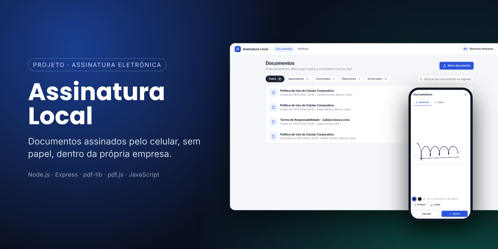
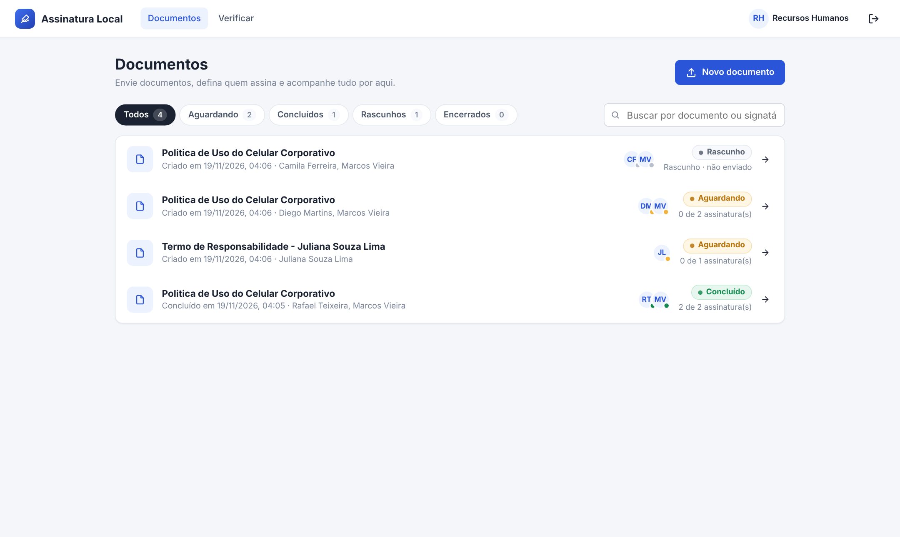
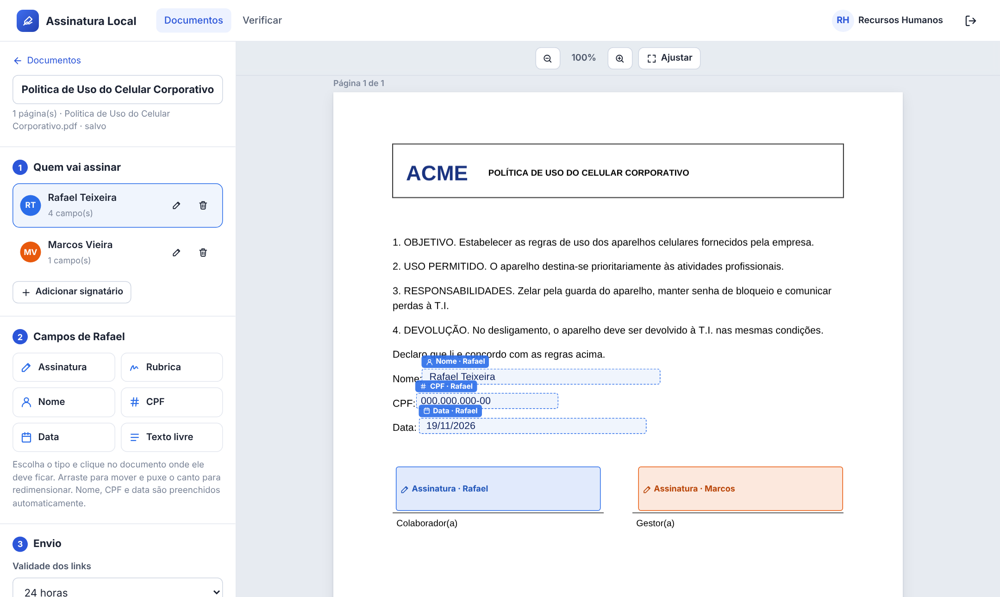
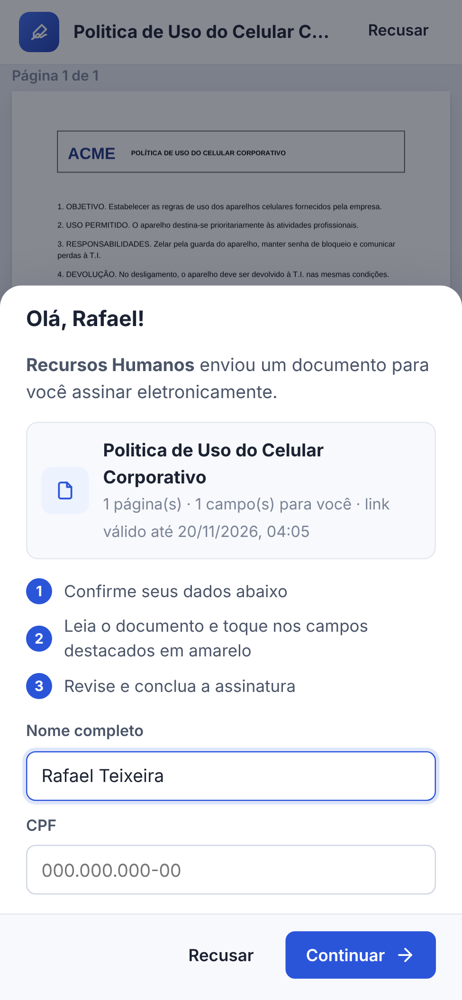
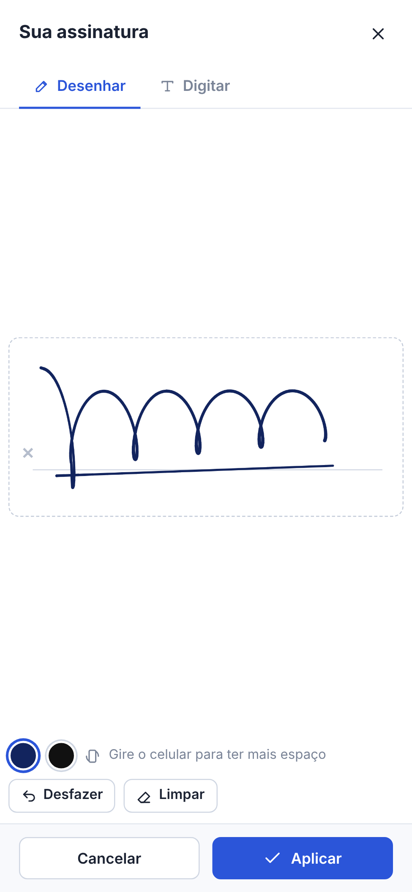
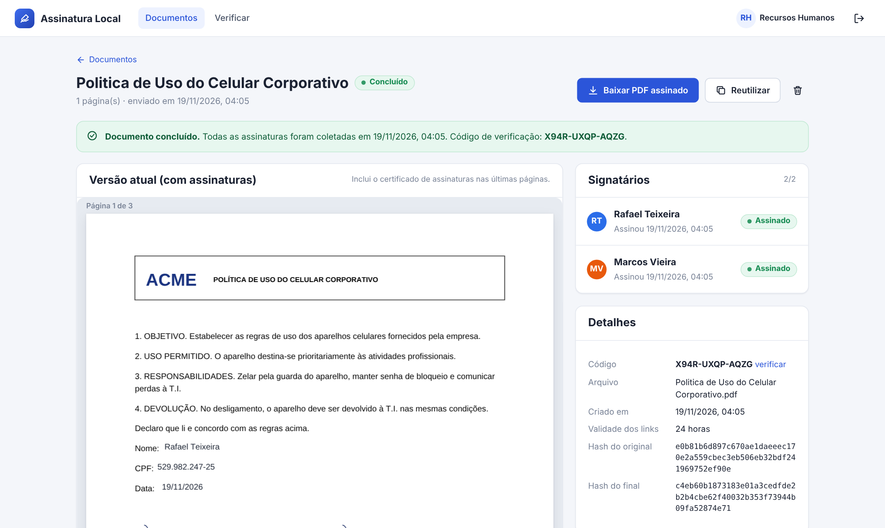
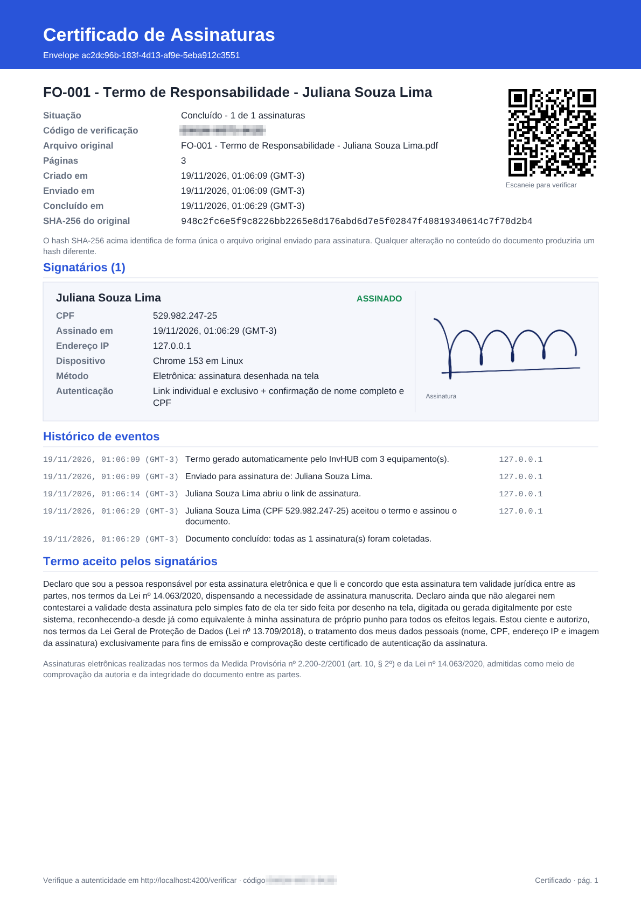

  

  
  
  
  

## A ideia

Todo documento que precisa de assinatura passa pelo mesmo caminho: imprimir, levar até a
pessoa, revisar, assinar, escanear e arquivar.

A **Assinatura Local** leva esse processo para o celular. É uma plataforma de assinatura
eletrônica, no estilo dos serviços conhecidos do mercado, que roda dentro da própria
empresa.

## Na prática

- O RH importa o documento, seleciona quem vai assinar e encaixa os campos necessários
  para a assinatura.
- O colaborador recebe um link, confere o documento e assina com o dedo no celular.
- O documento assinado volta sozinho para o sistema, pronto para consulta.

O projeto está em desenvolvimento há mais de 3 semanas.

Serve para qualquer documento interno: contratos, termos, políticas, comunicados e
autorizações.

## Vantagens

- ✅ **Sem papel:** nada de imprimir, escanear ou arquivar pastas
- ⚡ **Mais rápido:** o documento é enviado em poucos cliques e assinado na hora
- 💰 **Sem mensalidade:** não depende de serviço pago de assinatura
- 🔒 **Documentos na empresa:** nada é enviado para terceiros
- 👥 **Vários signatários:** cada pessoa recebe o seu link e o sistema mostra quem já assinou
- 🧾 **Comprovação:** cada documento sai com certificado de assinatura e código de verificação
- 📱 **Simples para quem assina:** basta um celular, sem instalar nada

## Telas

> Telas com **dados fictícios**.

| Painel de documentos | Encaixe dos campos de assinatura |
|---|---|
|  |  |

| Convite no celular | Assinatura com o dedo |
|---|---|
|  |  |

| Documento concluído | Certificado de assinaturas |
|---|---|
|  |  |

## Autor

**Fabio Borel**, assistente de T.I. e estudante de Engenharia da Computação na
Universidade Veiga de Almeida (UVA).

Projeto desenvolvido com auxílio de ferramentas de IA.
